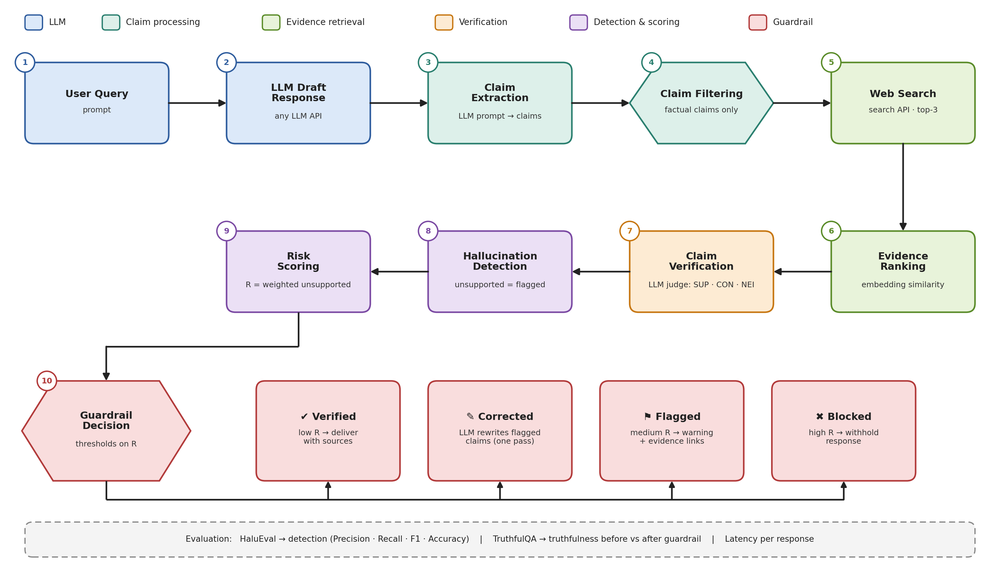

# Hallucination Auditor

A post-hoc guardrail for LLMs. It sits between a model and its user: given a `(question, draft answer)` pair, it extracts the factual claims in the answer, checks each one against web search evidence, computes a risk score **R**, and returns one of four actions:

| Action | When | What the user gets |
|---|---|---|
| **VERIFIED** | R < 0.2 | The draft, unchanged (plus source URLs) |
| **CORRECTED** | Mid-range R and at least one claim contradicted | A rewritten answer that fixes the wrong claims |
| **FLAGGED** | Mid-range R, no claim contradicted | The draft with a warning and sources |
| **BLOCKED** | R ≥ 0.5 | No answer (a block message) |

The project is a course project on hallucination detection. It has three parts:

1. **The auditor**: a Python pipeline (`pipeline.py`) that does the checking.
2. **Evaluation**: experiments on HaluEval and TruthfulQA that measure whether the auditor finds hallucinations and whether it makes answers more truthful.
3. **Deployment**: an OpenAI-style chat-completions proxy (`server.py`) that audits a company's own LLM before users see its answers.

The auditor does not modify the model and does not need a commercial API key. Both open models run on a free Kaggle GPU.

---

## Contents

- [How it works](#how-it-works)
- [Repository layout](#repository-layout)
- [Setup](#setup)
- [Usage](#usage)
- [Deployment as a proxy](#deployment-as-a-proxy)
- [Evaluation](#evaluation)
- [Configuration reference](#configuration-reference)
- [Limitations](#limitations)
- [Security and privacy](#security-and-privacy)
- [References](#references)

---

## How it works



Step numbers match the badges in the flowchart.

```
query + draft
  -> 3  Claim extraction (LLM)        atomic, self-contained claims
  -> 4  Claim filtering (LLM)         keep web-checkable factual claims
          (claims matching PRIVATE_REGEX are removed here)
  -> 5  Web search (DuckDuckGo, cached)   5 results per claim
  -> 6  Evidence ranking (MiniLM)         top 3 passages per claim
  -> 7  Claim verification (LLM judge)    SUP / CON / NEI per claim
  -> 8  Hallucination detection           CON and NEI count as unsupported
  -> 9  Risk score   R = (1.0 × #CON + 0.5 × #NEI) / #claims
  -> 10 Guardrail decision
          R < 0.2                  VERIFIED
          R ≥ 0.5                  BLOCKED
          between, any CON         CORRECTED  (one LLM rewrite)
          between, no CON          FLAGGED
```

- **SUP**: the evidence supports the claim. **CON**: the evidence contradicts it. **NEI**: not enough information.
- Claims are checked in parallel (`MAX_WORKERS`), and at most `MAX_CLAIMS` claims are checked per answer.
- If the search returns nothing for a claim, that claim is NEI.
- If the filter's reply cannot be parsed, every claim is kept (fail open).

### Models

Both models are served by one FastAPI server in `kaggle/`, which runs on a Kaggle GPU and is exposed through a Cloudflare tunnel.

| Role | Model | Setting |
|---|---|---|
| Verifier: extraction, filtering, judging, rewriting | Flan-T5-large (instruction-tuned T5) | `VERIFIER_MODEL=flan-t5` |
| The "company LLM" being audited | GPT-Neo-1.3B | `UPSTREAM_MODEL=gpt-neo` |

The two roles use different models on purpose. A weak model should not be the judge of its own output.

---

## Repository layout

```
proj/
├── Core auditor
│   ├── config.py          thresholds, weights and limits (all tunable numbers)
│   ├── llm.py             calls the Kaggle model server (chat + JSON helpers)
│   ├── search.py          DuckDuckGo search with an on-disk cache
│   ├── rerank.py          MiniLM embedding rerank of search results
│   ├── pipeline.py        the whole auditor: audit(query, draft)
│   └── utils.py           data loading, detection metrics, threshold tuning
│
├── Evaluation and demo
│   ├── eval_halueval.py   detection experiment on HaluEval (QA and general)
│   ├── eval_truthfulqa.py before/after truthfulness test on TruthfulQA
│   ├── app.py             Streamlit demo of the auditor
│   └── demo/              local web demo (live mode or replay of recorded results)
│
├── Proxy deployment
│   ├── server.py          FastAPI proxy: /v1/chat/completions, /health, /v1/models
│   ├── upstream.py        forwards requests to GPT-Neo on the Kaggle server
│   ├── client_example.py  example client call to the proxy
│   ├── test_server.py     offline tests of the proxy (mocked LLM and search)
│   └── Dockerfile         container image for the proxy (port 9000)
│
├── kaggle/                model server for Kaggle
│   ├── kaggle_server.py   FastAPI app that loads both models and serves /generate
│   ├── make_notebook.py   builds the notebook from kaggle_server.py
│   └── kaggle_notebook.ipynb   the notebook to import into Kaggle
│
├── docs/
│   └── IMPLEMENTATION_GUIDE.md  original course specification and reference list
│
├── results/               evaluation outputs and run logs (kept in git; the demo replays them)
├── data/                  HaluEval files (not in git, see Setup)
├── cache/                 search cache (not in git, created automatically)
├── hallucination_auditor_flowchart_simple.png
├── requirements.txt
├── .env.example           template for .env (copy it, never commit .env)
└── README.md
```

---

## Setup

**Requirements:** Python 3.10 or newer, and a Kaggle account (phone-verified, so Internet can be turned on). No local GPU or API key is needed.

### 1. Install the Python packages

```bash
python -m venv venv
venv\Scripts\activate          # Windows (macOS/Linux: source venv/bin/activate)
pip install -r requirements.txt
```

The first run of the auditor downloads the `all-MiniLM-L6-v2` embedding model.

### 2. Start the model server on Kaggle

1. Go to Kaggle, choose **Create → Notebook → File → Import Notebook**, and upload `kaggle/kaggle_notebook.ipynb`.
2. In session options, set **Accelerator: GPU T4 x2** and **Internet: On**.
3. Click **Run All**. The last cells print two values:
   - `KAGGLE_URL`: an address like `https://xxxx.trycloudflare.com`
   - `KAGGLE_API_KEY`: the shared secret (the same value as `MODEL_API_KEY` in the notebook)
4. Leave the notebook running. The URL changes every time the notebook restarts, so update `.env` when that happens. Kaggle sessions stop after a few hours of runtime or when idle.

To rebuild the notebook after editing `kaggle/kaggle_server.py`, run `python kaggle/make_notebook.py`.

### 3. Create `.env`

```bash
copy .env.example .env         # Windows (macOS/Linux: cp)
```

Then fill in `KAGGLE_URL` and `KAGGLE_API_KEY`. The full list of settings is in [Configuration reference](#configuration-reference).

### 4. Download the datasets

`data/` is not in git. Download the two HaluEval files into it:

```bash
mkdir data
curl -L -o data/qa_data.json https://raw.githubusercontent.com/RUCAIBox/HaluEval/main/data/qa_data.json
curl -L -o data/general_data.json https://raw.githubusercontent.com/RUCAIBox/HaluEval/main/data/general_data.json
```

You can also download them by hand from the `data` folder of [RUCAIBox/HaluEval](https://github.com/RUCAIBox/HaluEval).

TruthfulQA (`generation` config) is loaded automatically from Hugging Face by `eval_truthfulqa.py`.

---

## Usage

**Smoke test** (one answer, printed as JSON):

```bash
python -c "from pipeline import audit; import json; print(json.dumps(audit('Who wrote Hamlet?', 'Hamlet was written by Christopher Marlowe in 1720.'), indent=1, default=str))"
```

**Streamlit demo.** Enter a question and optionally a draft answer. If the draft is empty, the LLM writes one. The page shows the action, R, the original and final answers, and each claim with its verdict, reason and sources.

```bash
streamlit run app.py
```

**Web demo** (`demo/`). Open http://localhost:8000 after running:

```bash
python -m uvicorn demo.server:app --port 8000
```

- *Live mode* needs the Kaggle server and internet access.
- *Replay mode* uses the recorded results in `results/` and needs neither.

---

## Deployment as a proxy

The auditor can sit in front of a company's own LLM. Clients send chat-completions requests to the proxy, and the proxy audits each answer before returning it.

```
Chat UI / app  ->  server.py (:9000)  ->  GPT-Neo on Kaggle
                        |
                 audit(query, draft)
                        |
          VERIFIED / CORRECTED / FLAGGED / BLOCKED answer
          (+ sources, + X-Audit-* headers, + audit JSON)
```

### Run it

```bash
uvicorn server:app --host 0.0.0.0 --port 9000
python client_example.py       # sends one request and prints the audit field
python test_server.py          # offline tests, no Kaggle needed
```

Or in a container:

```bash
docker build -t hallucination-auditor .
docker run --env-file .env -p 9000:9000 hallucination-auditor
```

### Endpoints

| Endpoint | Purpose |
|---|---|
| `POST /v1/chat/completions` | Audited chat completion (the main endpoint) |
| `GET /v1/models` | Lists the model name |
| `GET /health` | Health check |

Each response carries:

- the answer, with a note or source list depending on the action;
- the headers `X-Audit-Action` and `X-Audit-Risk`;
- an extra `audit` field with per-claim verdicts and source URLs.

The proxy skips auditing when the request sends `X-Audit-Skip: true`, when the answer contains tool calls, or when the answer is shorter than `AUDIT_MIN_CHARS`.

### Behaviour switches

| Setting | Meaning |
|---|---|
| `AUDIT_MODE=monitor` | Answers pass through unchanged; audits are only logged. **Start here.** |
| `AUDIT_MODE=enforce` | Apply the verify / correct / flag / block actions. |
| `FAIL_MODE=open` | If search or the verifier fails, deliver the draft. |
| `FAIL_MODE=closed` | If search or the verifier fails, block the answer. |
| `PROXY_API_KEY` | Clients must send this as a Bearer token. Leave empty to disable. |
| `APPEND_SOURCES=true` | Add source URLs to delivered answers. |
| `LOG_CONTENT=false` | Log only the action, R and counts. Set `true` to store questions and answers in `results/audit_log.jsonl`. |
| `PRIVATE_REGEX` | Claims matching these patterns are never sent to web search. |

### Suggested rollout

1. Run in `monitor` mode on real traffic and read `results/audit_log.jsonl`.
2. Count how many answers would be flagged or blocked, and read a sample by hand.
3. Adjust `T1` and `T2` in `config.py`, then switch to `enforce`.

---

## Evaluation

### Research questions

1. **Truthfulness.** Does passing the model's answers through the auditor raise the share of truthful answers on TruthfulQA, compared with the plain answers?
2. **Unwarned errors.** After the guardrail, how often does a false answer still reach the user with no warning (delivered as VERIFIED or CORRECTED)?
3. **Detection.** On HaluEval, how well does R separate hallucinated answers from correct ones? Does web search help, compared with the LLM judging from its own knowledge?

### Experimental setup

| Part | Choice |
|---|---|
| Model being audited | GPT-Neo-1.3B (`UPSTREAM_MODEL`) |
| Auditor / judge | Flan-T5-large (`VERIFIER_MODEL`), a different model from the one audited |
| Evidence | DuckDuckGo, top 5 results per claim, top 3 kept by MiniLM rerank |
| Thresholds | T1 = 0.2 (VERIFIED below), T2 = 0.5 (BLOCKED at or above) |
| TruthfulQA | `generation` config, validation split, random sample of 100 (seed 42) |
| HaluEval | QA and general subsets, 100 samples each (seed 42). QA uses both the right and the hallucinated answer for each question. |
| Ablation | HaluEval QA with `--no_search` (the judge uses only its own knowledge) |

### Running the experiments

Start with a small `--n` to check the setup, then scale up:

```bash
python eval_halueval.py --task qa --n 100                 # detection, with web search
python eval_halueval.py --task qa --n 100 --no_search     # ablation: no web search
python eval_halueval.py --task general --n 100            # long ChatGPT responses
python eval_truthfulqa.py --n 100                         # before/after truthfulness
```

- The HaluEval runs are **resumable**: they append to `results/halueval_<task>_<search|nosearch>.jsonl` and skip finished samples.
- Search results are cached, so a crash or rate limit does not lose work.
- HaluEval splits the records 30% dev / 70% test. The threshold τ is tuned for best F1 on dev and the metrics are reported on test.
- The TruthfulQA run writes `results/truthfulqa.json`.

### Measures

- **HaluEval:** accuracy, precision, recall, F1, FPR and FNR, with "hallucinated" as the positive class. Latency mean and p95.
- **TruthfulQA:** truthful rate of the plain answer (baseline) and of the final answer, the action counts, and the unwarned-error rate. Always read the action counts next to the truthfulness number, because blocking alone raises truthfulness.

### Results files

| File | Contents |
|---|---|
| `results/halueval_qa_search.jsonl`, `results/halueval_qa_nosearch.jsonl` | Per-sample R and latency for the two HaluEval QA runs |
| `results/run_halueval_qa_*.log` | Console output of those runs, including the final metrics |
| `results/truthfulqa.json` | Per-question baseline and final truthfulness, action and latency |
| `results/run_truthfulqa.log` | Console output of the TruthfulQA run |

The demo replays these files, so keep them in git.

---

## Configuration reference

### `config.py` (code constants)

| Constant | Default | Meaning |
|---|---|---|
| `T1` | 0.2 | R below this → VERIFIED |
| `T2` | 0.5 | R at or above this → BLOCKED |
| `TOP_K_SEARCH` | 5 | Search results fetched per claim |
| `TOP_K_EVIDENCE` | 3 | Passages kept after the rerank |
| `W_CON` | 1.0 | Weight of a contradicted claim in R |
| `W_NEI` | 0.5 | Weight of a not-enough-information claim in R |
| `MAX_CLAIMS` | 8 | Maximum claims checked per answer (cost and latency) |
| `MAX_WORKERS` | 4 | Parallel verifier calls |

### `.env` (see `.env.example`)

| Variable | Purpose |
|---|---|
| `KAGGLE_URL` | Address of the Kaggle model server (changes on each notebook restart) |
| `KAGGLE_API_KEY` | Shared secret sent as a Bearer token (same value as `MODEL_API_KEY` in the notebook) |
| `VERIFIER_MODEL` | Model that verifies claims (`flan-t5`) |
| `UPSTREAM_MODEL` | Model whose answers the proxy audits (`gpt-neo`) |
| `AUDIT_MODE`, `FAIL_MODE`, `PROXY_API_KEY`, `APPEND_SOURCES`, `LOG_CONTENT` | Proxy behaviour (see [Behaviour switches](#behaviour-switches)) |
| `PRIVATE_REGEX` | Patterns separated by `;;`. Matching claims are never searched on the web. Example: `ProjectX;;\b\d{10}\b` |

---

## Limitations

- **Evidence is search snippets**, not full web pages, so some true claims come back NEI and get flagged.
- **The verifier is a small LLM** (Flan-T5-large). Its claim extraction and verdict JSON are noisy. NEI leading to a warning is the safety net.
- **DuckDuckGo** can rate-limit or return empty results. The cache helps, and empty results become NEI.
- **Private facts cannot be checked on the public web.** For internal documents, replace `web_search()` in `search.py` with a search over internal sources that returns the same `[{title, url, text}]` list.
- **HaluEval QA answers are short**, so claim extraction is tested mainly on the general subset.
- **The TruthfulQA judge is a prompt**, not the fine-tuned judge from the paper, so the numbers are not comparable to published ones.
- **Sample sizes are small** (about 100). With n = 100, the 95% margin on a proportion near 50% is about ±10 points, so differences of a few points are noise. There are no repeated runs or confidence intervals.
- **The proxy** loses streaming (the full answer is audited, then returned, as one chunk if the client asked for streaming), audits only the first choice, and passes tool-call responses through unaudited.
- **Results depend on the web.** DuckDuckGo results change over time, so reruns on other days may differ.

---

## Security and privacy

- **Never commit `.env`.** It is in `.gitignore`. `.env.example` holds placeholders only. If a key was ever committed, rotate it, because deleting the file does not remove it from git history.
- **Anything in an answer can leave your network.** Extracted claims are sent to the web search engine, and claims with evidence are sent to the verifier. The Kaggle tunnel is a public address. Use `PRIVATE_REGEX`, or self-host the search and the verifier, if the data is sensitive.
- **Audit logs can hold content.** `LOG_CONTENT=false` (the default) logs only counts and verdicts.
- **Set `PROXY_API_KEY`** before exposing the proxy beyond your machine.

---

## References

Full reference list and the original course specification: [docs/IMPLEMENTATION_GUIDE.md](docs/IMPLEMENTATION_GUIDE.md).

- J. Li et al. *HaluEval: A Large-Scale Hallucination Evaluation Benchmark for Large Language Models.* EMNLP 2023. https://aclanthology.org/2023.emnlp-main.397/
- S. Lin, J. Hilton, O. Evans. *TruthfulQA: Measuring How Models Mimic Human Falsehoods.* ACL 2022. https://aclanthology.org/2022.acl-long.229/
- L. Gao et al. *RARR: Researching and Revising What Language Models Say, Using Language Models.* ACL 2023. https://aclanthology.org/2023.acl-long.910/
